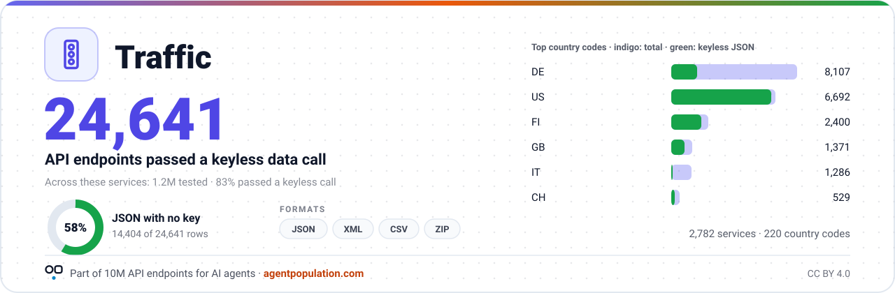
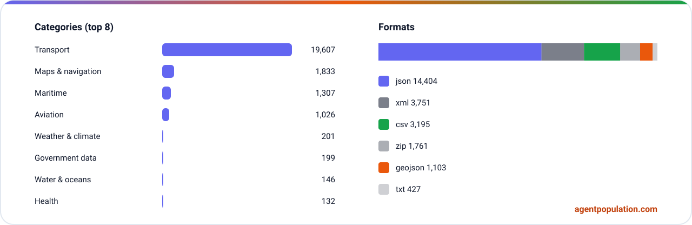

<p align="center"></p>

# 🚦 Traffic and roadworks API endpoints

**24,641 traffic and roadworks API endpoints that answered a keyless GET with a data body. For agent and app builders.**

<p align="center"><a href="#files"></a> <a href="#columns-and-tags"></a> <a href="#whats-inside"></a> <a href="#whats-inside"></a> <a href="LICENSE"></a></p>

<p align="center"><a href="#whats-in-it-for-you">What's in it</a> · <a href="#for-ai-agents">For AI agents</a> · <a href="#quick-start">Quick start</a> · <a href="#test-it-yourself">Test it yourself</a> · <a href="#files">Files</a> · <a href="#licence-and-credit">Licence</a> · <a href="#part-of-10m-api-endpoints-for-ai-agents">More packs</a></p>

This repository holds a 1,000-row sample and the services list; the full list of 24,641 endpoints is one download from the [latest release](https://github.com/agentpopulation/24k-traffic-apis-for-agents/releases/latest).

**Endpoints for building a traffic, roadworks or road-safety tool.** Traffic measurement and counting stations (Finland and Germany), road weather stations, crash, incident and closure map layers, roadworks and construction-site layers from European cities, traffic signals and road-safety statistics, as URLs that answered with no key on their test date.

Selection rule: rows where `tags has traffic AND NOT title matches /trafficking/i`, less the rows that a leave-out rule drops (each counted under Known limits).

16,023 of these 24,641 rows match the focus rule (below); the others are in the pack by the selection rule only, and Known limits says what they are. 5,959 rows (24.2%) are map layers on ArcGIS Online, where anyone can publish.

## In plain words

**What is an API endpoint?** An API endpoint is one web address that a program can ask for data, for example the latest reading at one weather station. A single service, such as a national weather agency, can have thousands of endpoints: one per station, city or dataset. This pack counts endpoints, not separate services.

**What does "passed a data call" mean?** On the date shown in each row, AgentPopulation sent one plain request to that address, with no password or key, and got a non-empty data body back (JSON, CSV, XML or a file): not an error page and not an empty result. Some bodies describe a dataset rather than hold its values; see Known limits. It shows the address answered with data on that day. It is not a promise that it answers today, and licences and usage limits were not reviewed.

## What's in it for you

Four ways to use this pack. Each bucket gives a count, a filter you can apply to the CSV, one example that passed, and a list of recommended starting points with the rule that picked them. Buckets overlap; a row can fit more than one.

Examples, recommended lists and the preview are drawn from rows that match this pack's focus rule, so a row that the selection rule put in this pack but that is about something else is not shown as a starting point. Counts cover the whole bucket.

<details>
<summary>The focus rule</summary>

Focus rule: `title matches /(?<!digi)traffic|trafic|traffico|tráfico|verkehr|verkeer|liikenne|\broads?\b|street|straße|strasse|motorway|highway|freeway|autobahn|interstate|crash|collision|accident|unfall|incident|roadwork|baustell|construction site|work zone|road ?clos|lane clos|detour|umleitung|sperrung|signal|ampel|counting (station|point)|zählstelle|aadt|congestion|speed|travel time|intersection|junction|vehicle|fahrzeug|cycl|bicycle|\bbikes?\b|pedestrian|tms|roadway|road_|roads_|_road|tempo[- ]?30|\bdtv\b|counter|counts?\b|truck|lorr|baumaßnahm|railroad crossing|signs?\b|citation|weigh-in-motion|school zone/i AND NOT title matches /vessel|\bships?\b|shipping|port call|maritime|seaport|\bports?\b|railway|\brail\b|\btrains?\b|air traffic|air passenger|airport|aviation|airline|aircraft|flight|buoy|cableway|ropeway|seilbahn/i AND NOT title matches /traffic areas?|verkehrsfläch|type of use/i AND NOT title matches /geotherm|species|flora|traffic stops?\b|well-being|trafficking|forces of nature|gateway service/i AND NOT host is apps.villingen-schwenningen.de AND NOT (host is genesis.destatis.de AND NOT title matches /accident|unfall|road|traffic participation|vehicle|motor/i)`

</details>

### 🤖 Agent tools: Traffic counts, road weather and incident layers an agent can query

**9,352** endpoints from 2,113 services · Wrap one URL pattern as a get_traffic tool: pass a station id or a road area, return vehicle counts, average speed or road-surface readings with the measurement time and a timeout.

6,276 of these are map-layer queries that asked for a few records (`resultRecordCount`); raise it or page through for the whole layer.

Start with: `tags has agent-ready AND title matches /(?<!digi)traffic|trafic|traffico|tráfico|verkehr|verkeer|liikenne|\broads?\b|street|straße|strasse|motorway|highway|freeway|autobahn|interstate|crash|collision|accident|unfall|incident|roadwork|baustell|construction site|work zone|road ?clos|lane clos|detour|umleitung|sperrung|signal|ampel|counting (station|point)|zählstelle|aadt|congestion|speed|travel time|intersection|junction|vehicle|fahrzeug|cycl|bicycle|\bbikes?\b|pedestrian|tms|roadway|road_|roads_|_road|tempo[- ]?30|\bdtv\b|counter|counts?\b|truck|lorr|baumaßnahm|railroad crossing|signs?\b|citation|weigh-in-motion|school zone/i AND NOT title matches /vessel|\bships?\b|shipping|port call|maritime|seaport|\bports?\b|railway|\brail\b|\btrains?\b|air traffic|air passenger|airport|aviation|airline|aircraft|flight|buoy|cableway|ropeway|seilbahn/i AND NOT title matches /violation|citation/i`

Example: [Traffic Lights Data Hamburg - STA Layerabfrage: P…](https://tld.iot.hamburg.de/v1.0/Datastreams?$filter=properties/serviceName%20eq%20%27HH_STA_traffic_lights%27%20and%20properties/layerName%20eq%20%27primary_signal%27&$expand=Observations%28$orderby=phenomenonTime%20desc;$top=10%29&$orderby=id&$top=100) · Hamburg · passed 2026-11-15

<details>
<summary>Recommended starting points: 8 services, picked by the stated criteria inside</summary>

**Recommended starting points.** Selected by stated criteria, not a ranking of quality: Services in this pack with the most endpoints that match this bucket and are tagged `agent-ready` (no key sent in the test call, JSON body, passed a data call). Ties go to the service with more country codes, then by name. Only services with at least one bucket row that matches the focus rule are listed, and the sample comes from those rows; the counts cover the whole bucket. The sample URL is the first row by URL sort after preferring, in this order: rows that match the bucket's sample preference when it has one, rows that return values rather than describe a dataset or a service (not ERDDAP /info/ pages, OGC GetCapabilities requests, bare OWS addresses, PxWeb tables, UN SDG series lists, Statistics Canada download pointers, WorldPop listings, GTFS validation reports, untitled rows or service root addresses), and agent-ready rows. Sample preference in this bucket: `url contains "tie.digitraffic.fi/api/tms/"`. Services named "ArcGIS organization" hold map layers from many owners and are added only when fewer than 5 other services match.

| Service (host) | Endpoints in bucket | In pack | Country codes in bucket | Formats in bucket | Sample URL that passed |
|---|---:|---:|---|---|---|
| Hamburg (tld.iot.hamburg.de) | 836 | 836 | DE | json | [Traffic Lights Data Hamburg - STA Layer…](https://tld.iot.hamburg.de/v1.0/Datastreams?$filter=properties/serviceName%20eq%20%27HH_STA_traffic_lights%27%20and%20properties/layerName%20eq%20%27primary_signal%27&$expand=Observations%28$orderby=phenomenonTime%20desc;$top=10%29&$orderby=id&$top=100) (2026-11-15) |
| Nationalhighways (webtris.nationalhighways.co.uk) | 336 | 336 | GB | json | [National Highways: WebTRIS traffic data…](https://webtris.nationalhighways.co.uk/api/v1.0/areas) (2026-11-15) |
| Transparenzportal Hamburg (archiv.transparenz.hamburg.de) | 162 | 1,298 | DE | json | [Showcase Traffic Light Forecast Hamburg…](https://archiv.transparenz.hamburg.de/hmbtgarchive/HMDK/datastreams_111908_snap_7.JSON) (2026-11-15) |
| Kingston University (ArcGIS Online) (services6.arcgis.com) | 154 | 190 | GB, US | json | [1) Merge Traffic Data 2018 Group 1 Grou…](https://services6.arcgis.com/NonisTlG4TcVAsSk/arcgis/rest/services/1%29%20Merge%20Traffic%20Data%202018%20Group%201%20Group%202%20Traffic%20Data/FeatureServer/0/query?where=1%3D1&outFields=*&returnGeometry=false&resultRecordCount=5&f=json) (2026-11-15) |
| Vvo Online (efa.vvo-online.de) | 144 | 273 | DE | json | [VVO Verkehrsverbund Oberelbe: EFA depar…](https://efa.vvo-online.de/VMSSL3/XML_DM_REQUEST?outputFormat=rapidJSON&type_dm=stop&name_dm=de%3A06533%3A28298&mode=direct&useRealtime=1&limit=10) (2026-11-15) |
| Azureedge (ghoapi.azureedge.net) | 130 | 130 | 130 codes | json | [WHO GHO: Estimated road traffic death r…](https://ghoapi.azureedge.net/api/RS_198?$filter=SpatialDim%20eq%20%27AFG%27) (2026-11-14) |
| Pape Dawson (maps.pape-dawson.com) | 122 | 122 | US | json | [maps.pape-dawson.com: Traffic/TRAFFIC\_\_…](https://maps.pape-dawson.com/server2/rest/services/Traffic/TRAFFIC__Crash/FeatureServer/0/query?where=1%3D1&outFields=*&resultRecordCount=10&f=json) (2026-11-15) |
| Vvs (www3.vvs.de) | 106 | 198 | DE | json | [VVS Verkehrs- und Tarifverbund Stuttgar…](https://www3.vvs.de/mngvvs/XML_DM_REQUEST?outputFormat=rapidJSON&type_dm=stop&name_dm=de%3A08111%3A170&mode=direct&useRealtime=1&limit=10) (2026-11-15) |

</details>

### 📱 App features: Roadworks, closures and crash maps

**1,080** endpoints from 448 services · Show roadworks and closures near a route on a map card with the start and end dates each layer gives, and past crashes as a road-safety layer.

104 of these are roadworks, construction-site, closure or detour layers; the others are crash, collision and incident layers.

Start with: `title matches /roadwork|baustell|construction site|work zone|road ?clos|lane clos|traffic clos|closures|detour|umleitung|sperrung|cantier|chantier|lavori|crash|collision|accident|unfall|incident|fatalit|injur/i AND (subcategory matches /ArcGIS|WFS|WMS|GEOJSON|KML|GML|OpenDataSoft|opendatasoft|socrata/i OR format is geojson)`

Example: [traffic\_closures](https://services1.arcgis.com/DwLTn0u9VBSZvUPe/arcgis/rest/services/traffic_closures/FeatureServer/0/query?where=1%3D1&outFields=*&returnGeometry=false&resultRecordCount=5&f=json) · ArcGIS Online layers (services1.arcgis.com, org DwLTn0u9VBSZvUPe) · passed 2026-11-15

<details>
<summary>Recommended starting points: 8 services, picked by the stated criteria inside</summary>

**Recommended starting points.** Selected by stated criteria, not a ranking of quality: Services in this pack with the most endpoints that match this bucket and passed a data call. Ties go to the service with more country codes, then by name. Only services with at least one bucket row that matches the focus rule are listed, and the sample comes from those rows; the counts cover the whole bucket. The sample URL is the first row by URL sort after preferring, in this order: rows that match the bucket's sample preference when it has one, rows that return values rather than describe a dataset or a service (not ERDDAP /info/ pages, OGC GetCapabilities requests, bare OWS addresses, PxWeb tables, UN SDG series lists, Statistics Canada download pointers, WorldPop listings, GTFS validation reports, untitled rows or service root addresses), and agent-ready rows. Sample preference in this bucket: `title matches /roadwork|baustell|construction site|work zone|road ?clos|lane clos|traffic clos|closures|detour|umleitung|sperrung|cantier|chantier|lavori/i`. Services named "ArcGIS organization" hold map layers from many owners and are added only when fewer than 5 other services match.

| Service (host) | Endpoints in bucket | In pack | Country codes in bucket | Formats in bucket | Sample URL that passed |
|---|---:|---:|---|---|---|
| University of Calgary (ArcGIS Online) (services2.arcgis.com) | 65 | 74 | CA, GB, US | json | [Calgary Traffic Incidents](https://services2.arcgis.com/XSv3KNGfmrd1txPN/arcgis/rest/services/Calgary_Traffic_Incidents/FeatureServer/0/query?where=1%3D1&outFields=*&returnGeometry=false&resultRecordCount=5&f=json) (2026-11-14) |
| Sarpy (geodata.sarpy.com) | 37 | 37 | US | json | [geodata.sarpy.com: PublicWorks/Accident…](https://geodata.sarpy.com/arcgis/rest/services/PublicWorks/Accidents/MapServer/1/query?where=1%3D1&outFields=*&resultRecordCount=10&f=json) (2026-11-15) |
| City of Lincoln/Lancaster County, NE Maps & Apps (ArcGIS Online) (services1.arcgis.com) | 21 | 33 | US | json | [LPD\_Incident\_Reports\_2013](https://services1.arcgis.com/wpJGOi6N4Rq5cqFv/arcgis/rest/services/LPD_Incident_Reports_2013/FeatureServer/0/query?where=1%3D1&outFields=*&returnGeometry=false&resultRecordCount=5&f=json) (2026-11-14) |
| Pape Dawson (maps.pape-dawson.com) | 20 | 122 | US | json | [maps.pape-dawson.com: Traffic/TRAFFIC\_\_…](https://maps.pape-dawson.com/server2/rest/services/Traffic/TRAFFIC__Crash/FeatureServer/0/query?where=1%3D1&outFields=*&resultRecordCount=10&f=json) (2026-11-15) |
| Vanderbilt University (ArcGIS Online) (services3.arcgis.com) | 16 | 17 | US | json | [2015\_Q1\_Traffic\_Crashes](https://services3.arcgis.com/58WV6GqBWodG9Kll/arcgis/rest/services/2015_Q1_Traffic_Crashes/FeatureServer/0/query?where=1%3D1&outFields=*&returnGeometry=false&resultRecordCount=5&f=json) (2026-11-14) |
| Hub Community (ArcGIS Online) (services9.arcgis.com) | 15 | 18 | US | json | [Hot\_Spot\_Traffic\_Collision\_Tim\_Mates](https://services9.arcgis.com/2ynJbr9BE17vXxR8/arcgis/rest/services/Hot_Spot_Traffic_Collision_Tim_Mates/FeatureServer/0/query?where=1%3D1&outFields=*&returnGeometry=false&resultRecordCount=5&f=json) (2026-11-15) |
| Tualatin (tualgis.ci.tualatin.or.us) | 12 | 23 | US | json | [tualgis.ci.tualatin.or.us: Police/Traff…](https://tualgis.ci.tualatin.or.us/server/rest/services/Police/TrafficAccidentDispatches/MapServer/0/query?where=1%3D1&outFields=*&resultRecordCount=10&f=json) (2026-11-15) |
| ATCS' iMap (ArcGIS Online) (services7.arcgis.com) | 11 | 11 | US | json | [CollisionType\_Merge1](https://services7.arcgis.com/o6plJdaG225lwC4T/arcgis/rest/services/CollisionType_Merge1/FeatureServer/0/query?where=1%3D1&outFields=*&returnGeometry=false&resultRecordCount=5&f=json) (2026-11-14) |

</details>

### 🧠 Grounding and data pipelines: Counting-station files and road-safety tables for scheduled loads

**9,092** endpoints from 421 services · Load counting-station files, crash tables and road-death rates on a schedule into your own store, so answers about traffic volumes and road safety cite a dated source.

1,586 of these are BASt yearly files of hourly counts at one German counting station (zip of CSV).

Start with: `(format in (csv, zip, xml, txt) OR subcategory contains "WHO Global Health Observatory") AND NOT title matches /vessel|\bships?\b|shipping|port call|maritime|seaport|\bports?\b|railway|\brail\b|\btrains?\b|air traffic|air passenger|airport|aviation|airline|aircraft|flight|buoy|cableway|ropeway|seilbahn/i AND NOT host is apps.villingen-schwenningen.de`

Example: [Automatic counting station Bad Schwartau 2003](https://www.bast.de/videos/2003/zst1108.zip) · Bast · passed 2026-11-14

<details>
<summary>Recommended starting points: 8 services, picked by the stated criteria inside</summary>

**Recommended starting points.** Selected by stated criteria, not a ranking of quality: Services in this pack with the most endpoints that match this bucket and passed a data call. Ties go to the service with more country codes, then by name. Only services with at least one bucket row that matches the focus rule are listed, and the sample comes from those rows; the counts cover the whole bucket. The sample URL is the first row by URL sort after preferring, in this order: rows that match the bucket's sample preference when it has one, rows that return values rather than describe a dataset or a service (not ERDDAP /info/ pages, OGC GetCapabilities requests, bare OWS addresses, PxWeb tables, UN SDG series lists, Statistics Canada download pointers, WorldPop listings, GTFS validation reports, untitled rows or service root addresses), and agent-ready rows. Sample preference in this bucket: `title matches /traffic count|counting|zählstelle|zaehlstelle|aadt|traffic volume|volume|traffic flow|flows|speed|traffic measurement|tms|verkehrsmenge|verkehrsstärke|census|crash|collision|accident|unfall|incident|fatalit|injur/i`. Services named "ArcGIS organization" hold map layers from many owners and are added only when fewer than 5 other services match.

| Service (host) | Endpoints in bucket | In pack | Country codes in bucket | Formats in bucket | Sample URL that passed |
|---|---:|---:|---|---|---|
| Bast (www.bast.de) | 1,586 | 1,586 | DE | zip | [Automatic counting station Bad Schwarta…](https://www.bast.de/videos/2003/zst1108.zip) (2026-11-14) |
| Transparenzportal Hamburg (archiv.transparenz.hamburg.de) | 1,135 | 1,298 | DE | xml, csv, zip, txt | [Zählstellenbereiche von Straßenverkehrs…](https://archiv.transparenz.hamburg.de/hmbtgarchive/HMDK/de_hh_inspire_wfs_svz_zaehlstellenbereiche_119386_snap_1.XML) (2026-11-15) |
| Toscana (dati.toscana.it) | 945 | 946 | IT | csv, txt | [EDIT (Epidemiology of the Determinants …](https://dati.toscana.it/dataset/7ef18c01-f493-4342-a23f-8aa6be337edd/resource/3bd7b767-b4c2-4df6-a15b-aa64dd5bcffb/download/tabellaopendefinitiva.csv) (2026-11-14) |
| s3.eu-west-2.amazonaws.com | 348 | 348 | GB | csv, xml | [s3.eu-west-2.amazonaws.com: Planned roa…](https://s3.eu-west-2.amazonaws.com/data.highwaysengland.co.uk/ha-roadworks/HE_roadworks_2021_05_31.xml) (2026-11-15) |
| www.landesdatenbank.nrw.de | 205 | 205 | DE | txt, xml | [Road traffic accidents and accidents - …](https://www.landesdatenbank.nrw.de/ldbnrwws/downloader/00/tables/46241-01i_00.csv) (2026-11-14) |
| geodienste.hamburg.de | 186 | 195 | DE | xml, zip | [Cycle traffic volumes (DB Rad+) Hamburg](https://geodienste.hamburg.de/HH_WFS_DB_Rad_Plus?SERVICE=WFS&VERSION=1.1.0&REQUEST=GetFeature&typename=de.hh.up:aktuelles_jahr%2Cde.hh.up:letzte_woche%2Cde.hh.up:jahr2022%2Cde.hh.up:jahr2023%2Cde.hh.up:jahr2024%2Cde.hh.up:jahr2025) (2026-11-14) |
| Azureedge (ghoapi.azureedge.net) | 130 | 130 | 130 codes | json | [WHO GHO: Estimated road traffic death r…](https://ghoapi.azureedge.net/api/RS_198?$filter=SpatialDim%20eq%20%27AFG%27) (2026-11-14) |
| Vvo Online (efa.vvo-online.de) | 129 | 273 | DE | xml | [VVO Verkehrsverbund Oberelbe: EFA depar…](https://efa.vvo-online.de/VMSSL3/XML_DM_REQUEST?outputFormat=XML&type_dm=stop&name_dm=de%3A06533%3A28298&mode=direct&useRealtime=1&limit=10) (2026-11-15) |

</details>

### 🧪 Evals and testing: Station queries, map layers and files to test a traffic tool

**24,641** endpoints · 2,782 services · 220 country codes · 6 formats · Run your traffic tool against a fixed set of URLs across formats; check that station, count, speed, location and time parse, and keep last_tested as the baseline for your own re-tests.

Start with: the whole pack

Example: [Showcase Traffic Light Forecast Hamburg - STA Lay…](https://archiv.transparenz.hamburg.de/hmbtgarchive/HMDK/datastreams_111908_snap_7.JSON) · Transparenzportal Hamburg · passed 2026-11-15

<details>
<summary>Recommended starting points: 8 services, picked by the stated criteria inside</summary>

**Recommended starting points.** Selected by stated criteria, not a ranking of quality: Services in this pack that returned the most different formats, then the most endpoints that passed a data call, then by name: a mix of response shapes to test parsers and tool calls. Only services with at least one bucket row that matches the focus rule are listed, and the sample comes from those rows; the counts cover the whole bucket. The sample URL is the first row by URL sort after preferring, in this order: rows that match the bucket's sample preference when it has one, rows that return values rather than describe a dataset or a service (not ERDDAP /info/ pages, OGC GetCapabilities requests, bare OWS addresses, PxWeb tables, UN SDG series lists, Statistics Canada download pointers, WorldPop listings, GTFS validation reports, untitled rows or service root addresses), and agent-ready rows. Services named "ArcGIS organization" hold map layers from many owners and are added only when fewer than 5 other services match.

| Service (host) | Endpoints in bucket | In pack | Country codes in bucket | Formats in bucket | Sample URL that passed |
|---|---:|---:|---|---|---|
| Transparenzportal Hamburg (archiv.transparenz.hamburg.de) | 1,298 | 1,298 | DE | xml, json, csv, zip, txt | [Showcase Traffic Light Forecast Hamburg…](https://archiv.transparenz.hamburg.de/hmbtgarchive/HMDK/datastreams_111908_snap_7.JSON) (2026-11-15) |
| Dublinked Open Data for the Dublin Regio (data.smartdublin.ie) | 87 | 87 | IE | csv, geojson, xml, json, zip | [DLR Road Traffic Special Speed Limit By…](https://data.smartdublin.ie/dataset/05da7841-8cc0-4b15-80ee-099c076add64/resource/2f4f8674-d0b1-4c2e-8caf-25b930196fe8/download/dlr-speed-limit-bye-laws-2024.geojson) (2026-11-14) |
| Open Data-Portal der Stadt Leipzig (geodienste.leipzig.de) | 82 | 82 | DE | geojson, xml, csv, json, txt | [Straßennetz, Stadt Leipzig - Das Straße…](https://geodienste.leipzig.de/l3/OpenData/wfs?VERSION=1.3.0&REQUEST=getFeature&typeName=OpenData%3AStrassen_Segmente&outputFormat=csv) (2026-11-15) |
| daten.stadt.sg.ch | 46 | 46 | CH | json, xml, csv, txt, geojson | [strassenverkehrsunfallorte](https://daten.stadt.sg.ch/api/explore/v2.1/catalog/datasets/strassenverkehrsunfallorte/records?limit=1) (2026-11-12) |
| geoservice.norderstedt.de | 20 | 20 | DE | xml, csv, geojson, json, zip | [Baustelleninformation - Download als CSV](https://geoservice.norderstedt.de/geoserver/vms/ows?service=WFS&version=1.0.0&request=GetFeature&typeName=vms:stvkinfoweb&outputFormat=CSV) (2026-11-15) |
| Hong Kong Open Data Portal (static.data.gov.hk) | 15 | 15 | HK | zip, csv, txt, json, xml | [Traffic Speed Map (City Dashboard Versi…](https://static.data.gov.hk/opendata/dataset/traffic-speed/traffic-speed-info.json) (2026-11-15) |
| geo.sv.rostock.de | 124 | 124 | DE | xml, csv, geojson, json | [Light signalling systems](https://geo.sv.rostock.de/download/opendata/lichtsignalanlagen/lichtsignalanlagen.json) (2026-11-14) |
| Wien (data.wien.gv.at) | 79 | 79 | AT | xml, csv, geojson, json | [Traffic lights with acoustic identifica…](https://data.wien.gv.at/daten/geo?service=WFS&request=GetFeature&version=1.1.0&typeName=ogdwien:AKUSTISCHEAMPELOGD&srsName=EPSG:4326&outputFormat=json) (2026-11-14) |

</details>

The same lists are in [recommended.json](recommended.json), ready for an agent to load.

## Questions an agent can answer with this pack

- How many vehicles did a National Highways road site in England count in each 15-minute interval of a day? Try [National Highways: WebTRIS daily 15-min traffic r…](https://webtris.nationalhighways.co.uk/api/v1.0/reports/Daily?sites=100&start_date=01062026&end_date=01062026&page=1&page_size=96) (Nationalhighways, passed 2026-11-15).
- What are the live traffic counts at a Brussels Mobility detector? Try [Brussels Mobility: All live traffic counts](https://data.mobility.brussels/traffic/api/counts/?request=live) (Mobility, passed 2026-11-15).
- Which road events does NZ Transport Agency Waka Kotahi list for a New Zealand region? Try [Waka Kotahi NZTA: TrafficNZ road events by region](https://trafficnz.info/service/traffic/rest/4/events/byregion/1/10) (Trafficnz, passed 2026-11-15).
- What is the estimated road traffic death rate for a country? Try [WHO GHO: Estimated road traffic death rate (per 1…](https://ghoapi.azureedge.net/api/RS_198?$filter=SpatialDim%20eq%20%27AFG%27) (Azureedge, passed 2026-11-14).

## What "passed a data call" means

> [!NOTE]
> On the date in `last_tested` (IST), one GET to the URL, sent with no key, returned HTTP 2xx and a non-empty data body. HTML pages and empty results did not pass. The `format` column records what came back. This is a test result for that date, not a promise that the URL answers today. Licences, terms, rate limits, accuracy and freshness were not reviewed. Endpoints are URLs, not separate APIs; many share one service. This pack was tested 10–15 Nov 2026; snapshot 15 Nov 2026.

## For AI agents

Start from keyless JSON endpoints (`agent-ready`). The code below loads `recommended.json` and calls the first recommended service in the Agent tools bucket, with a timeout (`node examples/agent-start.mjs --recommended`). With no argument, `node examples/agent-start.mjs` calls the most recently tested agent-ready row of the sample; pass a `.csv` or `.csv.gz` path to use that file instead. See [examples/agent-start.mjs](examples/agent-start.mjs).

```js
// Node 18+. Loads recommended.json (the local copy, or the raw file on GitHub) and calls one keyless JSON endpoint.
import fs from 'node:fs';

const RAW = 'https://raw.githubusercontent.com/agentpopulation/24k-traffic-apis-for-agents/main/recommended.json';
const rec = fs.existsSync('recommended.json')
  ? JSON.parse(fs.readFileSync('recommended.json', 'utf8'))
  : await (await fetch(RAW)).json();

const pick = rec.buckets.find((b) => b.id === 'agent').services[0];
try {
  const res = await fetch(pick.sample_url, {
    headers: { 'User-Agent': 'agent-example/1.0' },
    signal: AbortSignal.timeout(15000),
  });
  console.log(pick.service, res.status, res.headers.get('content-type'));
  console.log((await res.text()).slice(0, 300));
} catch (err) {
  console.log(`did not answer now; last passed ${pick.sample_last_tested} (${err.message})`);
}
```

How an agent picks an endpoint:

1. Filter to `agent-ready` and your country or topic.
2. Prefer the newest `last_tested` and the larger services.
3. Call with a timeout and check the body before you use it.

## Quick start

The examples run against the sample in `data/` out of the box (1,000 rows). Each takes an optional path to a `.csv` or `.csv.gz` file instead.

```bash
git clone https://github.com/agentpopulation/24k-traffic-apis-for-agents.git
cd 24k-traffic-apis-for-agents
python examples/quickstart.py
node examples/quickstart.mjs
node examples/agent-start.mjs
```

Full list: download `Traffic_API_Endpoints_AgentPopulation_Snapshot_2026-11-15.csv.gz` (24,641 rows, 1.2 MB) from [releases/latest](https://github.com/agentpopulation/24k-traffic-apis-for-agents/releases/latest), then gunzip it and pass its path. The scripts also read the `.csv.gz` as it is.

```bash
gunzip Traffic_API_Endpoints_AgentPopulation_Snapshot_2026-11-15.csv.gz
python examples/quickstart.py Traffic_API_Endpoints_AgentPopulation_Snapshot_2026-11-15.csv
node examples/quickstart.mjs Traffic_API_Endpoints_AgentPopulation_Snapshot_2026-11-15.csv
```

### curl

Quote the URL: some contain commas.

```bash
curl -sL "https://raw.githubusercontent.com/agentpopulation/24k-traffic-apis-for-agents/main/data/Traffic_API_Endpoints_AgentPopulation_Sample.csv" | head -n 4
curl -s --max-time 15 "https://tld.iot.hamburg.de/v1.0/Datastreams?$filter=properties/serviceName%20eq%20%27HH_STA_traffic_lights%27%20and%20properties/layerName%20eq%20%27primary_signal%27&$expand=Observations($orderby=phenomenonTime%20desc;$top=10)&$orderby=id&$top=100" | head -c 600
```

### Python

Standard library only: [examples/quickstart.py](examples/quickstart.py) reads the sample, or the path you pass, keeps agent-ready rows and calls the most recently tested one.

<details>
<summary>The code</summary>

```python
# Python 3, standard library only. Run from a clone of this repository:
#   python examples/quickstart.py [path]
# With no path it reads the sample in data/. Pass the full list from the latest release (.csv or .csv.gz) instead.
# Keeps agent-ready rows and calls the most recently tested one.
import csv
import gzip
import os
import re
import sys
import urllib.request

HERE = os.path.dirname(os.path.abspath(__file__))
path = sys.argv[1] if len(sys.argv) > 1 else os.path.join(HERE, "..", "data", "Traffic_API_Endpoints_AgentPopulation_Sample.csv")
opener = gzip.open if path.endswith(".gz") else open
with opener(path, "rt", newline="", encoding="utf-8") as f:
    rows = list(csv.DictReader(f))

agent = [r for r in rows if "agent-ready" in r["tags"].split("|")]
# Newest test date first; URLs that describe a dataset or a service rather than return values go last.
DESCRIBES = re.compile(r"/erddap/info/|action-report\.json$|[?&]request=getcapabilities|/GeoArea/[^/?]+/List|getFullTableDownloadCSV|hub\.worldpop\.org", re.I)
agent.sort(key=lambda r: r["last_tested"], reverse=True)
agent.sort(key=lambda r: 1 if DESCRIBES.search(r["url"]) else 0)
print(len(rows), "rows,", len(agent), "agent-ready")
if not agent:
    sys.exit(0)

row = agent[0]
req = urllib.request.Request(row["url"], headers={"User-Agent": "agent-example/1.0"})
try:
    with urllib.request.urlopen(req, timeout=15) as res:
        body = res.read(1_000_000).decode("utf-8", "replace")
        print(res.status, res.headers.get("Content-Type"))
        print(body[:300])
except Exception as err:
    print(f"did not answer now; last passed {row['last_tested']} ({err})")
```

</details>

### JavaScript

Reads the sample as JSON because the CSV has quoted commas.

<details>
<summary>The code</summary>

```js
// Node 18+. Reads the sample as JSON (the CSV has quoted commas), local file first.
import fs from 'node:fs';

const FILE = 'data/Traffic_API_Endpoints_AgentPopulation_Sample.json';
const rows = fs.existsSync(FILE)
  ? JSON.parse(fs.readFileSync(FILE, 'utf8'))
  : await (await fetch('https://raw.githubusercontent.com/agentpopulation/24k-traffic-apis-for-agents/main/data/Traffic_API_Endpoints_AgentPopulation_Sample.json')).json();

const row = rows.find((r) => r.tags.includes('agent-ready'));
const res = await fetch(row.url, { headers: { 'User-Agent': 'agent-example/1.0' }, signal: AbortSignal.timeout(15000) });
console.log(res.status, (await res.text()).slice(0, 300));
```

</details>

### Agent tools

[examples/agent-tools.json](examples/agent-tools.json) holds two tool definitions in the shape most tool-calling APIs accept (name, description, JSON Schema); rename `parameters` if yours uses another key. [examples/quickstart.mjs](examples/quickstart.mjs) implements them:

- `find_endpoints` searches the agent-ready rows of the list by words, country code (their format is json). When you load the tools of more than one pack, prefix the names (for example `traffic_find_endpoints`) so they do not clash.
- `fetch_endpoint` calls one URL, **refuses any URL that is not in the list** and does not follow redirects. The allowlist is built from the CSV, so a URL injected into a prompt is refused.

The same two tools can sit behind an MCP server.

## Test it yourself

Re-test endpoints from the sample with the same rule: HTTP 2xx and a non-empty body that is not an HTML page. Node 18+, no packages.

```bash
node tools/test-endpoints.mjs
```

It tests the first 50 URLs and prints one line: tested, passed, did not pass. Options: a `.csv` or `.csv.gz` path (the full list from the release), `--limit 50`, `--timeout-ms 10000`, `--out results.csv`. The results file holds `url`, `status`, `passed`, `content_type`, `ms` and `checked_at`; a status of `timeout` or `error:<code>` means no HTTP answer came back. It is polite: GET only, no key sent, at most 4 requests in flight, one at a time per listed host, at least 1 second between requests to one listed host, and reading stops once 256 kB of a body is kept. Redirects are followed and may lead to another host. `results.csv` is in `.gitignore`.

## Preview

One row from each of the five largest services among rows that match the focus rule, services with rows that return values first.

| Title | Service | Country | Format | Tested | Link |
|---|---|---|---|---|---|
| Automatic counting station Bad Schwartau 2003 | Bast | DE | zip | 2026-11-14 | [www.bast.de](https://www.bast.de/videos/2003/zst1108.zip) |
| Showcase Traffic Light Forecast Hamburg - STA Layerabfrage:… | Transparenzportal Hamburg | DE | json | 2026-11-15 | [archiv.transparenz.hamburg.de](https://archiv.transparenz.hamburg.de/hmbtgarchive/HMDK/datastreams_111908_snap_7.JSON) |
| dati.toscana.it: Region of Tuscany - SGCFIPILI - Station P1… | Toscana | IT | csv | 2026-11-15 | [dati.toscana.it](https://dati.toscana.it/dataset/0069ab3b-4c26-4d72-9c8e-358180567f23/resource/4fa6f353-42cc-4876-a363-2ad69b944950/download/sgc-fi-pi-li-a12-a11-livorno-ss1-uscita-direzione-firenze_110_2025.csv) |
| Traffic Lights Data Hamburg - STA Layerabfrage: Primärsigna… | Hamburg | DE | json | 2026-11-15 | [tld.iot.hamburg.de](https://tld.iot.hamburg.de/v1.0/Datastreams?$filter=properties/serviceName%20eq%20%27HH_STA_traffic_lights%27%20and%20properties/layerName%20eq%20%27primary_signal%27&$expand=Observations%28$orderby=phenomenonTime%20desc;$top=10%29&$orderby=id&$top=100) |
| Fintraffic Digitraffic: AIS last position: LIFEGUARD 002 (M… | Digitraffic | FI | geojson | 2026-11-15 | [meri.digitraffic.fi](https://meri.digitraffic.fi/api/ais/v1/locations?mmsi=111265582) |

Browse the 1,000-row sample: [Sample CSV](data/Traffic_API_Endpoints_AgentPopulation_Sample.csv) · [Sample JSON](data/Traffic_API_Endpoints_AgentPopulation_Sample.json).

## What's inside

<p align="center"></p>

<details>
<summary>Country codes: 220</summary>

| Code | Country | Endpoints | |
|---|---|---:|---|
| DE | Germany | 8,107 | `████████████████████` |
| US | United States | 6,692 | `████████████████▌` |
| FI | Finland | 2,400 | `█████▉` |
| GB | United Kingdom | 1,371 | `███▍` |
| IT | Italy | 1,286 | `███▏` |
| CH | Switzerland | 529 | `█▎` |
| IE | Ireland | 383 | `█` |
| EU | European Union | 326 | `▊` |
| CA | Canada | 299 | `▊` |
| AT | Austria | 187 | `▌` |
| | other 210 codes | 2,394 | |
| | global or unknown | 667 | `█▋` |

</details>

<details>
<summary>Categories: top 8</summary>

| Category | Endpoints | |
|---|---:|---|
| Transport & Mobility | 19,607 | `████████████████████` |
| Navigation & Geo/Maps | 1,833 | `█▉` |
| Maritime | 1,307 | `█▍` |
| Aviation | 1,026 | `█` |
| Weather & Climate | 201 | `▎` |
| Government & Open Data | 199 | `▎` |
| Hydrology & Oceans | 146 | `▏` |
| Health | 132 | `▏` |

</details>

Formats: json 14,404 · xml 3,751 · csv 3,195 · zip 1,761 · geojson 1,103 · txt 427

<details>
<summary>Largest services: top 25 of 2,782</summary>

| Service | Host | Endpoints | Keyless JSON | |
|---|---|---:|---:|---|
| Bast | www.bast.de | 1,586 | 0 | `████████████████████` |
| Transparenzportal Hamburg | archiv.transparenz.hamburg.de | 1,298 | 163 | `████████████████▍` |
| Digitraffic † | rata.digitraffic.fi | 1,181 | 1,181 | `██████████████▉` |
| Digitraffic | meri.digitraffic.fi | 1,122 | 696 | `██████████████▏` |
| Flightradar24 † | www.flightradar24.com | 994 | 994 | `████████████▌` |
| Toscana | dati.toscana.it | 946 | 0 | `███████████▉` |
| Hamburg | tld.iot.hamburg.de | 836 | 836 | `██████████▌` |
| s3.eu-west-2.amazonaws.com | s3.eu-west-2.amazonaws.com | 348 | 0 | `████▍` |
| Nationalhighways | webtris.nationalhighways.co.uk | 336 | 336 | `████▎` |
| Vvo Online | efa.vvo-online.de | 273 | 144 | `███▌` |
| Eurostat dissemination API | ec.europa.eu | 267 | 148 | `███▍` |
| www.landesdatenbank.nrw.de | www.landesdatenbank.nrw.de | 205 | 0 | `██▋` |
| Vvs | www3.vvs.de | 198 | 106 | `██▌` |
| geodienste.hamburg.de | geodienste.hamburg.de | 195 | 0 | `██▌` |
| Kingston University (ArcGIS Online) | services6.arcgis.com | 190 | 190 | `██▍` |
| Llv | etab.llv.li | 153 | 153 | `█▉` |
| ArcGIS Online layers (services-eu1.arcgis.com, org SEIHigRppeVyVssQ) | services-eu1.arcgis.com | 152 | 152 | `█▉` |
| ArcGIS Online layers (services4.arcgis.com, org 2hkgSaFLPcil5qfg) | services4.arcgis.com | 147 | 147 | `█▉` |
| geoserver.digitale-mrn.de † | geoserver.digitale-mrn.de | 147 | 0 | `█▉` |
| Azureedge | ghoapi.azureedge.net | 130 | 130 | `█▋` |
| geo.sv.rostock.de | geo.sv.rostock.de | 124 | 10 | `█▋` |
| Pape Dawson | maps.pape-dawson.com | 122 | 122 | `█▌` |
| Berlin Government Open Data Portal | gdi.berlin.de | 121 | 1 | `█▌` |
| Geoportal Falkensee † | www.geoportal-falkensee.de | 117 | 0 | `█▌` |
| ArcGIS Online layers (services6.arcgis.com, org tuxY7TQIaDhLWARO) | services6.arcgis.com | 112 | 112 | `█▍` |

† No row of these services matches the focus rule: the selection rule put them in this pack, so they are not used as a starting point.

</details>

<details>
<summary>Rows per test date: 10–15 Nov 2026</summary>

| Date (IST) | Endpoints | |
|---|---:|---|
| 2026-11-15 | 16,697 | `████████████████████` |
| 2026-11-14 | 7,435 | `████████▉` |
| 2026-11-13 | 50 | `▏` |
| 2026-11-12 | 259 | `▎` |
| 2026-11-11 | 192 | `▎` |
| 2026-11-10 | 8 | `▏` |

</details>

## Files

| File | Rows | Size | Use |
|---|---:|---:|---|
| [data/Traffic_API_Services_AgentPopulation.csv](data/Traffic_API_Services_AgentPopulation.csv) | 2,782 | 158.5 kB | One row per service with its endpoint count in this pack |
| [data/Traffic_API_Endpoints_AgentPopulation_Sample.csv](data/Traffic_API_Endpoints_AgentPopulation_Sample.csv) | 1,000 | 320.2 kB | The sample: focus-rule rows first, each service in proportion to its share; ArcGIS Online layers count as one service |
| [data/Traffic_API_Endpoints_AgentPopulation_Sample.json](data/Traffic_API_Endpoints_AgentPopulation_Sample.json) | 1,000 | 518.0 kB | The same rows as JSON, tags as an array |
| [Traffic_API_Endpoints_AgentPopulation_Snapshot_2026-11-15.csv.gz](https://github.com/agentpopulation/24k-traffic-apis-for-agents/releases/latest) | 24,641 | 1.2 MB | The full list, gzipped CSV: a download from the latest release, checked by `SHA256SUMS.txt` |
| [tools/test-endpoints.mjs](tools/test-endpoints.mjs) | | | Re-tests endpoints from the sample or the full list |

Sample size: 1,000 rows, which is 1,000 or one third of the pack rounded down, whichever is smaller. Rows that match the focus rule come first. Each service gets rows in proportion to its share of those rows, at least one for the largest services and at most 50% of the sample while other services have rows; ArcGIS Online layers count as one service, whatever their organisation. Within a service, agent-ready rows, rows that return values and the newest test dates come first, and rows are written in turn across services. Service root addresses are placed at the end of the sample.

Full list: download `Traffic_API_Endpoints_AgentPopulation_Snapshot_2026-11-15.csv.gz` (24,641 rows, 1.2 MB) from [releases/latest](https://github.com/agentpopulation/24k-traffic-apis-for-agents/releases/latest), then gunzip it and pass its path. The scripts also read the `.csv.gz` as it is.

Excel users: Data > From Text/CSV, UTF-8. Files are UTF-8 without a byte-order mark and comma-separated.

## Columns and tags

<details>
<summary>Columns, types and tags</summary>

| Column | Type | Example | Meaning |
|---|---|---|---|
| url | string | [https://www.bast.de/videos/2003/zst1108…](https://www.bast.de/videos/2003/zst1108.zip) | The address that was tested |
| title | string | Automatic counting station Bad Schwarta… | Station, dataset or feed name |
| service | string | Bast | The service the endpoint belongs to; joins to the services file together with host |
| host | string | www.bast.de | Host name of the address |
| country | string | DE | ISO 3166-1 alpha-2 code, or EU; empty when global or unknown |
| category | string | Transport & Mobility | Category of the endpoint |
| subcategory | string |  | Left empty from the 15 Nov 2026 snapshot; kept so the columns stay the same |
| format | string | zip | What the test call returned: json, csv, geojson, xml, gtfs, zip, txt and so on |
| tags | string | `transit\|traffic\|no-key` | Tags separated by \| |
| last_tested | date | 2026-11-14 | Date of the test call, YYYY-MM-DD (IST) |

| Tag | Rows | Meaning |
|---|---:|---|
| no-key | 24,641 | No key was sent in the test call |
| traffic | 24,641 | Topic tag |
| transit | 19,638 | Topic tag |
| agent-ready | 14,404 | No key sent, JSON body, passed a data call on last_tested |
| json | 14,404 | Format of the body |
| maps | 12,663 | Topic tag |
| open-data | 4,576 | Topic tag |
| xml | 3,751 | Format of the body |
| csv | 3,195 | Format of the body |
| maritime | 1,343 | Topic tag |
| statistics | 1,329 | Topic tag |
| aviation | 1,139 | Topic tag |
| geojson | 1,103 | Format of the body |
| oceans | 970 | Topic tag |
| government | 625 | Topic tag |
| weather | 220 | Topic tag |
| health | 210 | Topic tag |
| science | 198 | Topic tag |
| water | 146 | Topic tag |
| economy | 120 | Topic tag |
| parking | 120 | Topic tag |
| environment | 109 | Topic tag |
| rivers | 108 | Topic tag |
| hazards | 92 | Topic tag |
| forecast | 58 | Topic tag |
| climate | 51 | Topic tag |
| energy | 41 | Topic tag |
| air-quality | 30 | Topic tag |
| elevation | 18 | Topic tag |
| bike-share | 13 | Topic tag |
| gbfs | 9 | GBFS feed |
| finance | 7 | Topic tag |
| groundwater | 6 | Topic tag |
| tides | 5 | Topic tag |
| floods | 4 | Topic tag |
| gtfs | 3 | GTFS feed |
| mcp-server | 3 | Topic tag |
| geocoding | 2 | Topic tag |
| earthquakes | 1 | Topic tag |

A machine-readable copy of this dictionary is in [datapackage.json](datapackage.json).

</details>

## Known limits

- 32.9% of rows carry country code DE; 667 rows have no code (global or unknown).
- 375 rows come from PxWeb or Statistics Canada services. Some statistics endpoints return metadata or a pointer on GET; the table may need a second request or a POST.
- 18 rows are ERDDAP /info/ pages: they describe a dataset rather than return its values, so the series needs a second request.
- 7,796 rows are map-layer queries with resultRecordCount set: the tested call asked for a few records; change the query to get the full layer.
- 231 rows carry limit=1: the tested call asked for one record; raise the limit or page through.
- 507 rows are open-data portal dataset records, which may return a dataset record with links rather than the table itself.
- 2,188 rows are files (zip 1,761, txt 427) rather than bodies an agent reads directly.
- 2 rows are service root addresses (the host alone or an API or version path such as /v1, with no query), which may describe the service rather than return data; the sample, examples and recommended lists use other rows first.
- 5,959 rows are layers on ArcGIS Online, where anyone can publish: some are class projects, tests or copies. Check the owner and the fields before you rely on one.
- 5 URLs carry `application=AgentPopulation`; set your own application name when you call them.
- 5,601 rows carry the traffic tag but have no road-traffic term in the title. Check the title before you use one; they are not used as starting points.
- 3,431 rows are rail, shipping, port or air traffic (Finnish live trains and port calls, US vessel traffic layers, Eurostat rail tables), not road traffic.
- 130 rows are WHO road traffic death rates, one per country; most of the country codes in this pack come from them.
- 148 rows are Eurostat JSON-stat queries that ask for the latest period only (`lastTimePeriod=1`); remove it for the series.
- Many map layers carry no country code, and some carry one that does not match the place in their title; check the title or the host when you filter by country.
- Stations and feeds can go quiet after their test date; re-test a URL before you rely on it.
- Not in this pack: endpoints that need a key or a POST, and URLs that did not pass.
- Left out: 1 row with an email-like address.
- Left out: 338 ArcGIS Survey123 layers (they can hold people's form answers).
- Left out: 1 layer marked editable in the title (it can hold entries that people added).
- Left out: 65 police traffic-stop layers (they can hold details of people stopped).
- Left out: 23 ArcGIS layers that keep a form's default service name (they can hold people's form answers).
- Left out: 948 ArcGIS class or coursework layers (lab, assignment, exam, quiz, lesson, exercise, tutorial and final-project layers, copies of class layers, layers named for a person or a person's home, and layers whose name ends in a person's name or holds a student number).
- Left out: 19 ArcGIS layers that hold reports, comments, submissions or form responses sent in by the public.
- Left out: 10 rows of server information from Mastodon, PeerTube, Lemmy, Nostr and other social network servers (instance documents name the server's contact person).
- Left out: 946 development-plan map services (GetCapabilities) of Villingen-Schwenningen, Germany, tagged by the German word Verkehr: not traffic data.
- Left out: 1,215 land-use tables ("settlement and traffic areas") of German municipalities: not traffic measurements.
- Left out: 643 Destatis economy, trade and enterprise tables tagged by the word Verkehr: not road traffic.

## Licence and credit

> [!IMPORTANT]
> This list (URLs, titles, tags and test results) is © 2026 AgentPopulation, released under [CC BY 4.0](https://creativecommons.org/licenses/by/4.0/). Credit AgentPopulation and link agentpopulation.com. The data each endpoint returns belongs to its provider and stays under that provider's terms; this licence does not cover it.

Copy-ready credit:

`Traffic and roadworks API endpoints by AgentPopulation (https://agentpopulation.com), CC BY 4.0, snapshot 15 Nov 2026.`

GitHub's "Cite this repository" button reads [CITATION.cff](CITATION.cff).

<!-- agentpopulation:start -->
## Part of 10M API endpoints for AI agents

This pack is one of the 24 topic packs of [10m-open-apis-for-ai-agents](https://github.com/agentpopulation/10m-open-apis-for-ai-agents), the open collection by [AgentPopulation](https://agentpopulation.com). Target: 10 million+ open API endpoints that pass a keyless API call.

AgentPopulation has tested over 5 million API endpoints: 5,129,834 tested, 3,726,509 passed a data call (snapshot 15 Nov 2026). This is the traffic and roadworks pack: 24,641 endpoints from 2,782 services. Packs overlap, so an endpoint can appear in more than one.

For the latest tested endpoints, search [agentpopulation.com/apis](https://agentpopulation.com/apis). This pack is a snapshot from 15 Nov 2026.

Sibling packs that share the most URLs with this one: [270k-transit-apis-for-agents](https://github.com/agentpopulation/270k-transit-apis-for-agents) (24,641 shared) · [2.5m-agent-ready-apis](https://github.com/agentpopulation/2.5m-agent-ready-apis) (14,404 shared) · [380k-maps-gis-apis-for-agents](https://github.com/agentpopulation/380k-maps-gis-apis-for-agents) (1,833 shared) · [24k-maritime-apis-for-agents](https://github.com/agentpopulation/24k-maritime-apis-for-agents) (1,307 shared) · [270k-water-apis-for-agents](https://github.com/agentpopulation/270k-water-apis-for-agents) (1,129 shared) · [25k-aviation-apis-for-agents](https://github.com/agentpopulation/25k-aviation-apis-for-agents) (1,026 shared). The rest are listed in [10m-open-apis-for-ai-agents](https://github.com/agentpopulation/10m-open-apis-for-ai-agents).

Questions, pack requests, reports of endpoints that stopped answering and requests to remove a row go to [Discussions](https://github.com/agentpopulation/10m-open-apis-for-ai-agents/discussions), or to [@agentpopulation](https://x.com/agentpopulation) on X. The packs are a work in progress and corrections are welcome.

Spotted a wrong row or a dead URL? Tell us on X: [@agentpopulation](https://x.com/agentpopulation).

If this pack saved you time, a star helps others find it.

---

Compiled by [AgentPopulation](https://agentpopulation.com) with [AP Desk](https://github.com/agentpopulation/apdesk) · [10m-open-apis-for-ai-agents](https://github.com/agentpopulation/10m-open-apis-for-ai-agents)

<!-- agentpopulation:end -->
